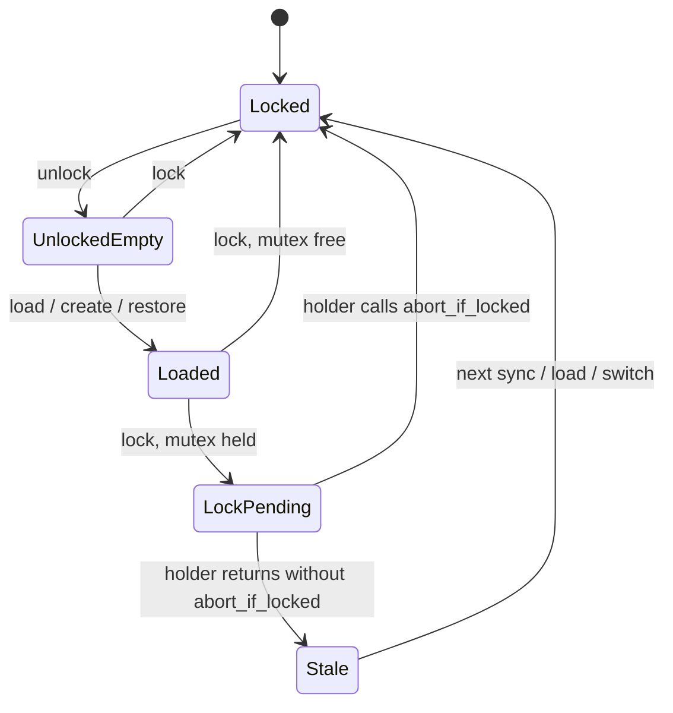

# Lock lifecycle

What "locked" means in `WalletApp` (`crates/wallet-core/src/app.rs`), which combinations of its parts occur, and one gap. Tests in `app::lock_lifecycle_tests` pin each statement below.

## The parts

| Part | Where | Meaning |
|---|---|---|
| Secrets | `secrets.is_locked()` | The decrypted mnemonic is in memory or not. This is what `is_locked()` reports. |
| State | `state: Mutex<Option<WalletState>>` | The loaded wallet, including the signer and MWEB keys. |
| Park | `parked` | Other accounts this session opened. They hold signing keys too. |
| Pending | `pending_lock: AtomicBool` | `lock()` could not take the state mutex. Whoever holds it should drop the state. |

`lock()` wipes the secrets and the park at once and never waits. It drops the state only when `try_lock` succeeds. Otherwise it sets Pending and returns.

## States

| State | Secrets | State | Pending |
|---|---|---|---|
| Locked | locked | none | false |
| UnlockedEmpty | unlocked | none | false |
| Loaded | unlocked | some | false |
| LockPending | locked | some | true, a holder will check |
| Stale | locked | some | true, nobody is checking |

`Stale` is the gap below. The other four are intended.

## What holds today

- Lock with the mutex free empties state and park immediately, and every command returns `Locked` (`lock_with_a_free_mutex_drops_state_and_park`).
- Lock during a long operation wipes the mnemonic at once. The state goes when that operation calls `abort_if_locked` (`lock_during_a_held_mutex_defers_to_abort_if_locked`). `sync`, `resync_mweb_inner`, `load_locked`, and `switch_wallet` do.
- Unlock decrypts the mnemonic only. Nothing is loaded until `load` (`unlock_does_not_load_state`).
- The broadcast pump runs while locked without unlocking or loading anything (`pump_while_locked_stays_locked_and_empty`). It reads `churn_job.json`, `churn_armed.json`, and the wallet meta, and sends a transaction that was signed while unlocked.

## Gap: state can outlive Lock

About 55 other functions take the state mutex with `lock_state()` and never call `abort_if_locked`; for example `summary`, `churn_status`, and the settings reads. If the user locks during one of them:

1. `lock()` sees the mutex held, wipes the mnemonic, and sets Pending.
2. The holder returns without checking Pending. The wallet, its signer, and the MWEB keys stay in memory.
3. Every later command calls `ensure_unlocked` first and returns `Locked`, so nothing clears the state either.
4. `pump_churn_broadcast` takes the mutex with `try_lock`, finds the state, and uses it while the wallet reports locked.

The state stays until the next `sync`, `load`, or account switch. `lock_racing_a_short_holder_still_drops_state` reproduces it and is `#[ignore]`d until this is fixed. Run it with `cargo test -p wallet-core lock_lifecycle -- --ignored`.

The window is short (the holder has to be mid-call when Lock lands). Auto-lock fires from a UI timer (`main.ts`, around `autoLockMinutes`) that runs alongside other timers calling into the wallet, so the race does not need a user clicking at the wrong moment. Nothing is signed from the stale state; the risk is key material in memory after the user was told the wallet is locked.

## Recommended fix

Make the check impossible to forget instead of adding `abort_if_locked` to 55 call sites:

- `lock_state()` returns a guard that drops the state when Pending is set or the secrets are locked, before handing it out. Every holder then clears a pending lock on the way in, and the pump finds `None` and takes its locked path.
- Alternatively, `lock()` spawns a short retry that takes the mutex once it is free and drops the state.

The first keeps everything synchronous and also covers the pump. Either way, un-ignore the test above.

## Does this need a transition table like the self-spend job?

Not yet. There are four intended states and one bug. The fix above removes `Stale` without new structure. Revisit if more parts join the lifecycle, such as a biometric unlock or a watch-only mode with its own loaded state.
