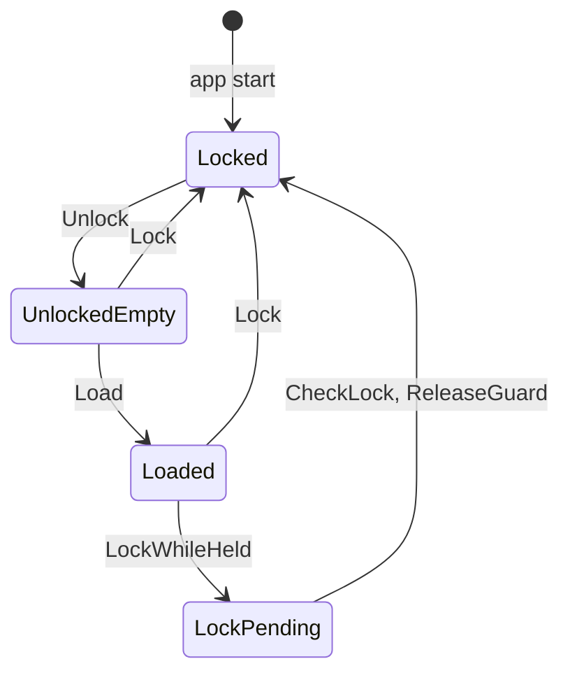

# Lock lifecycle

What "locked" means in `WalletApp` (`crates/wallet-core/src/app.rs`), which combinations of its parts occur, and how Lock reaches a holder that is mid-call. Tests in `app::lock_lifecycle_tests` pin each statement below.

## The parts

| Part | Where | Meaning |
|---|---|---|
| Secrets | `secrets.is_locked()` | The decrypted mnemonic is in memory or not. This is what `is_locked()` reports. |
| State | `state: Mutex<Option<WalletState>>` | The loaded wallet, including the signer and MWEB keys. |
| Park | `parked` | Other accounts this session opened. They hold signing keys too. |
| Pending | `pending_lock: AtomicBool` | `lock()` could not take the state mutex. Whoever holds it drops the state. |

`lock()` wipes the secrets and the park at once and never waits. It drops the state only when `try_lock` succeeds. Otherwise it sets Pending and returns, and the holder's `StateGuard` finishes the job.

## States

The diagram is generated from `lock::LOCK_TRANSITIONS` (`crates/wallet-core/src/lock.rs`). `lock_table_matches_docs` fails when it is stale; refresh it with `UPDATE_DIAGRAMS=1 cargo test -p wallet-core lock_table_matches_docs`. `lock_table_matches_behavior` drives a real `WalletApp` through every row, so the table cannot drift from the code either.

<!-- lock-transitions:begin (generated; do not edit) -->

<!-- lock-transitions:end -->

| State | Secrets | State | Pending |
|---|---|---|---|
| Locked | locked | none | false |
| UnlockedEmpty | unlocked | none | false |
| Loaded | unlocked | some | false |
| LockPending | locked | some | true, held by a `StateGuard` |

Load also covers create and restore. Any other combination is a bug; `observe` in the tests panics on one.

## StateGuard

Every `WalletApp` method that needs the wallet takes the state mutex through `lock_state()`, which returns a `StateGuard`:

- **On acquire**, if Lock was pressed (Pending set or secrets locked), it drops the state, finishes the lock, and returns `Locked`.
- **On release** (`Drop`), it does the same check. A holder that never thinks about locking still drops the signer the moment it lets go of the mutex (`lock_during_holder_drops_state_on_release`, `lock_racing_a_short_holder_still_drops_state`).
- **`check_lock()`** gives long operations an early exit. `sync`, `resync_mweb_inner` and `load_locked` call it between phases so a Lock during a long Electrum or MWEB pass does not wait for the pass to end (`lock_during_a_held_mutex_defers_to_check_lock`).

Finishing a lock clears the park and the insights endpoint, re-locks the secrets, and clears Pending.

Other ways in, each for code that has to run while locked:

| Function | Used by | Behavior |
|---|---|---|
| `try_lock_state()` | `pump_churn_broadcast`, `diagnostics` | Does not wait. After Lock it hands back a guard with no state, so the pump takes its locked path. |
| `lock_state_gate()` | `prefetch_transparent` | Waits without refusing; the pre-unlock Electrum prefetch only needs the mutex as a gate. Release still drops state if locked. |
| `lock_state_raw()` | `wipe`, `discard_resident` | The bare mutex. Both only remove state. `wipe` runs from the locked screen (`wipe_works_while_locked`). |

Do not add callers to `lock_state_raw()`. New code uses `lock_state()`.

## What holds

- Lock with the mutex free empties state and park immediately, and every command returns `Locked` (`lock_with_a_free_mutex_drops_state_and_park`, `lock_state_refuses_while_locked`).
- Lock while any holder has the mutex wipes the mnemonic at once, and the state goes when the holder checks or releases.
- Unlock decrypts the mnemonic only. Nothing is loaded until `load` (`unlock_does_not_load_state`).
- The broadcast pump runs while locked without unlocking or loading anything (`pump_while_locked_stays_locked_and_empty`). It reads `churn_job.json`, `churn_armed.json`, and the wallet meta, and sends a transaction that was signed while unlocked.

## Closed: state could outlive Lock

Before `StateGuard`, only `sync`, `resync_mweb_inner`, `load_locked` and `switch_wallet` checked Pending (through `abort_if_locked`). About 55 other holders, such as `summary`, `churn_status` and the settings reads, returned with the signer still loaded when Lock landed mid-call, and `pump_churn_broadcast` then used that state while the wallet reported locked. It stayed until the next sync, load or account switch. Auto-lock fires from a UI timer alongside other timers that call into the wallet, so the race did not need an unlucky click. The guard closes it for every holder at once, and the reproducing test now runs in CI.

## Known edge

If the user unlocks again while a holder from before the Lock still has the mutex, that holder's release still sees Pending and re-locks the secrets. The user sees the lock screen once more. This keeps the rule simple (a Lock always finishes) and errs toward locked.
