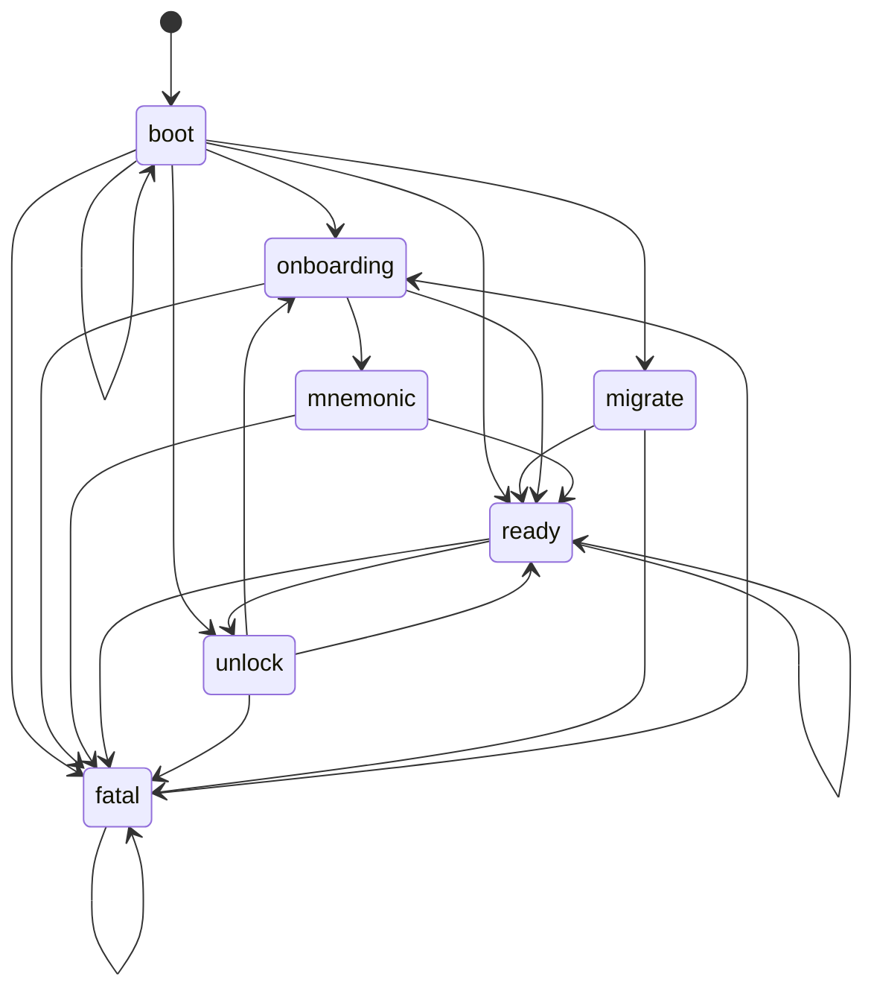

# UI lifecycle phases

The top-level screen the UI shows (`currentPhase` in `ui/src/main.ts`). `setPhase` refuses any change that `PHASE_FROM` in `ui/src/phases.ts` does not list, and logs `Ignored phase change <from> -> <to>` to the console.

The diagram is generated from `PHASE_FROM`. `npm run check:diagrams` fails in CI when it is stale; refresh it with `npm run check:diagrams -- --write`.

<!-- ui-phases:begin (generated; do not edit) -->

<!-- ui-phases:end -->

| Phase | Shown when | Entered by |
|---|---|---|
| `boot` | App start, before the backend answers | `boot()` (re-entered on retry) |
| `onboarding` | No wallet on disk | `boot()`, `wipeAndOnboard` from the fatal or locked screen |
| `mnemonic` | A new wallet was just created | Create on the onboarding screen |
| `migrate` | A plaintext store needs a passphrase | `boot()` |
| `unlock` | The wallet is locked | `boot()`, Lock and auto-lock from `ready` |
| `ready` | Loaded and unlocked | `enterReady` after boot, unlock, migrate, restore, backup done, or an account switch |
| `fatal` | The wallet data cannot be read | Any phase |
